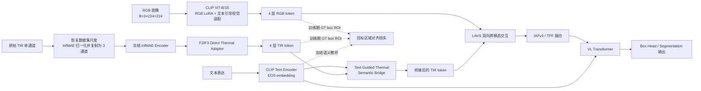

# InfMAE-A5Bridge：当前模型方案

> **实验名**：`InfMAEA5Bridge` 
> **任务**：RGB-T referring expression grounding（RefFLIR / `rgbtvg_flir`） 
> **输入分辨率**：224 × 224 
> **本文范围**：记录当前正在训练的直接 InfMAE 热成像前端版本；它不是原论文完整 RGBT-VGNet 的逐项复现，也不包含 GQR。

## 1. 方案目标与边界

当前版本想验证一个明确的问题：**当 TIR 分支不再使用 RGB 预训练 CLIP 时，如何利用冻结的 InfMAE 热成像表征，并仍保持其与文本指代语义对齐。**

因此，模型采用“直接 InfMAE TIR 前端 + 目标区域语义监督 + 文本引导热成像残差”的路线。

- RGB 分支保留原始 RGBT-VGNet 的 CLIP ViT-B/16、文本引导视觉适配和 RGB LoRA（rank=16）。
- TIR 分支**完全绕过 TIR CLIP 与 TIR LoRA**，改由官方 `InfMAE/InfMAE.pth` 的冻结编码器提供特征。
- LAVS、IAFv3/TPF、VL Transformer、框回归头和分割相关输出保持原训练框架的接口与主干逻辑。
- 不启用 GQR，也**不加载**此前 A2、GQR 或其他实验的最佳 checkpoint 作为初始化。
- 训练初始化使用项目的通用 MMVG 预训练权重；InfMAE 使用独立的官方预训练权重。

`--lora_r_ir 48` 仍会出现在统一训练命令中，以保持命令兼容性；但在本方案中 TIR CLIP 未被调用，因此该 TIR LoRA rank 不参与实际 TIR 前向计算。

## 2. 总体数据流

推理时不使用 GT 框、GT mask 或任何额外标签。A5Bridge 中的文本到 TIR patch 注意力完全由输入图像和指代表达计算。

## 3. RGB、文本与 TIR 前端

### 3.1 RGB 与文本分支

- 视觉骨干：`CLIP ViT-B/16`，视觉维度为 768。
- 视觉层输出：原实现抽取 4 个层级，输入给后续 LAVS。
- RGB LoRA：rank=16。
- 文本：CLIP Text Encoder 输出 512 维 EOS embedding；它既用于原有文本引导视觉适配，也作为 A5Bridge 的冻结语义查询。

这里的文本 EOS embedding 在新对齐损失和语义桥中会 `detach()`，即 TIR 学习去匹配已有 RGB/文本语义空间，而不会反向拉动该教师空间。

### 3.2 TIR 预处理与冻结 InfMAE

训练数据传入的第 4 通道已按数据集统计量标准化。为避免误把 CLIP 的输入统计量送入 InfMAE，先执行：

1. 反标准化为物理 TIR 标量图像；RefFLIR 使用均值 `0.5337`、标准差 `0.2562`；
2. 采用 InfMAE 预训练统计量重新标准化：均值 `0.425`、标准差 `0.200`；
3. 复制为 3 通道，送入 InfMAE。

InfMAE 编码器来自 `InfMAE/InfMAE.pth`，严格加载、永久冻结且固定为 eval mode。对于 224 × 224 输入，它提供：

| 特征 | 形状 | 作用 |
| --- | --- | --- |
| F2 | `[B, 384, 28, 28]` | H/8 的细节热特征 |
| F3 | `[B, 768, 14, 14]` | H/16 的语义热特征 |

当前官方 InfMAE checkpoint 的位置编码固定在 224 输入；因此该直接前端不应未经适配直接改到 288/320 分辨率。

### 3.3 Direct Thermal Adapter

原始 LAVS 需要 4 组 TIR token，每组形状为 `[B, 197, 768]`（1 个 CLS + 14×14 个 patch）。`InfMAEDirectThermalAdapter` 将 F2/F3 映射到这一接口：

1. 用 1×1 投影分别映射 F2、F3 到 768 维，并做 LayerNorm；F3 投影在初始化时尽量保持 identity。
2. 双线性下采样 F2 到 14×14；与 F3 按可学习系数融合。F2 的初始权重约为 `0.1`，作为低权重细节补偿。
3. 构造全局 token，并通过 4 个轻量、层级独立的 bottleneck residual adapter 生成 4 组 token。
4. 每一层输出均为 `[B, 197, 768]`，所以 LAVS 之后的接口不需要改动。

InfMAE 编码器本身不参与梯度更新；Direct Thermal Adapter 是可学习的。

## 4. A5Bridge：文本引导 TIR 语义桥

仅有 A3/A5 的训练期辅助对齐头无法在推理时直接改善特征，因为该头不会进入 LAVS。`TextGuidedThermalSemanticBridge` 将已经学习到的 TIR 语义投影显式注入检测路径。

对每一个 TIR 层级，记原始 token 为：

\[
V^{(l)}=[c^{(l)},P^{(l)}], \quad P^{(l)}\in\mathbb{R}^{B\times196\times768}
\]

其中 CLS token `c` 保持不变。共享的 TIR-to-text projector 将 patch 映射至 CLIP 语义空间：

\[
S^{(l)}=\operatorname{NormProj}_{768\rightarrow512}(P^{(l)})
\]

使用冻结的文本 EOS embedding `t` 计算 patch 级语义注意力：

\[
a_i=\operatorname{softmax}_i\left(
\frac{\langle \operatorname{norm}(S_i),\operatorname{norm}(\operatorname{sg}[t])\rangle}{\tau}
\right),\quad \tau=0.07
\]

文本被线性映射回 768 维后，以残差方式注入对应 patch：

\[
P'_i=P_i+\tanh(\beta)\cdot r\cdot a_i\cdot W_t\operatorname{sg}[t]
\]

- `β` 是单个可学习标量，初始化为 0，因此 `tanh(β)=0`。
- `r` 是 A3/A5 的 adapter warmup 比例。
- 初始时 `P'=P`，所以开启桥接模块时前向与 Direct-InfMAE A2 等价；训练仅在有收益时逐渐打开这条残差。
- bridge 在**进入 LAVS 之前**作用，4 个层级共享其文本投影和残差增益。
- 语义桥不访问 GT 框，因此训练和推理都可使用。

日志中的 `semantic_bridge_gain`、`semantic_bridge_attention_entropy`、`semantic_bridge_attention_peak` 分别用于观察残差是否被打开、注意力是否过于平均或过度塌缩。

## 5. 保留的主干融合与输出

桥接后的 TIR token 与 RGB token 沿用原有后端：

1. **LAVS 双向跨模态交互**：每个层级均执行 RGB→TIR 与 TIR→RGB 的交叉融合，再以残差方式更新双方 token。
2. **多层特征投影**：4 层视觉 token 拼接并投影到 VL hidden dimension（当前为 512）。
3. **IAFv3 / TPF**：执行原有局部、全局和照度感知的 RGB-TIR token 融合。当前 `FusionMethod=InfMAEA5Bridge` 会进入 `_fusion_iafv3`，而不是 GQR 路由器。
4. **VL Transformer**：拼接回归 token、融合视觉 token 与文本 token，进行多模态推理。
5. **预测头**：回归 token 经 `bbox_embed(...).sigmoid()` 输出归一化框；原有 mask/segmentation 相关输出接口仍保留。

因此，当前创新点只改变 TIR 前端以及训练期语义约束，不重写 LAVS、TPF/IAFv3 或 VL Transformer。

## 6. 训练期目标区域对齐（A5）

训练时使用 GT 归一化框，而不是预测框。对 RGB 与 TIR 的**预 LAVS、预 bridge** patch token 先对四个层级求均值，再用 4×4 `grid_sample` ROI pool 得到目标区域描述：

\[
z_{rgb}=\operatorname{ROIpool}(P_{rgb},b_{gt}),\qquad
z_{tir}=\operatorname{ROIpool}(P_{tir},b_{gt})
\]

这样做有两个目的：

- 小目标即使小于单个 14×14 patch，也能得到连续可导的目标特征；
- 辅助损失监督的是 bridge 前的真实 TIR 表征，桥接残差无法通过改变自身输出来“取巧”。

总损失可概括为：

\[
\mathcal{L}=\mathcal{L}_{\text{MMVG-grounding}}
+ \lambda_{tt}r_{tt}\mathcal{L}_{\text{TIR→Text}}
+ \lambda_{rt}r_{rt}\mathcal{L}_{\text{RGB→TIR}}
\]

其中主损失保持现有 MMVG 训练项（box、GIoU、contrastive、mask/segmentation 等训练配置）。新增项如下：

| 新增项 | 定义 | 当前最大权重 | 教师是否冻结 |
| --- | --- | ---: | --- |
| TIR→Text | 目标区域 TIR embedding 与同 batch / 跨卡文本 embedding 的 InfoNCE | `0.05` | 文本 EOS 冻结 |
| RGB→TIR | `1 - cos(z_tir, z_rgb)` 的目标级语义迁移 | `0.02` | RGB CLIP target 冻结 |

跨 GPU 会收集已 detach 的文本候选作为 InfoNCE 负样本；当前有效全局 batch 为 96，因此候选数通常为 12 个 micro-batch 样本的跨卡集合（具体值见日志）。

## 7. 当前训练配置

| 项目 | 当前值 |
| --- | --- |
| `FusionMethod` | `InfMAEA5Bridge` |
| 数据集 | `rgbtvg_flir` / RefFLIR |
| 图像大小 | 224 |
| GPU | 2 张卡（物理 GPU 4、5） |
| 每卡 batch | 6 |
| world size / 梯度累积 | 2 / 8 |
| 有效全局 batch | 96 |
| epoch | 120 |
| 主学习率 | `1e-4`，cosine schedule |
| 对齐投影头学习率 | `1e-4` |
| RGB LoRA rank | 16 |
| TIR-to-Text 温度 | 0.07 |
| GT target pool | 4×4 |

课程式启用方式：

| 模块/损失 | 启动 epoch | ramp | 目的 |
| --- | ---: | ---: | --- |
| TIR→Text 对齐 | 40 | 10 epoch | 先建立稳定的 TIR-文本映射 |
| adapter 梯度与 bridge 前向增益 | 40 | 10 epoch | 避免随机投影早期扰动原定位路径 |
| RGB→TIR 迁移 | 50 | 10 epoch | 在文本对齐稳定后再引入 RGB 语义教师 |

初始化来源：

- 通用 MMVG 预训练：`merged_fixed_best_checkpoint_peft0111.pth`；
- 热成像专家：`InfMAE/InfMAE.pth`；
- A5 对齐 projector 从 CLIP visual projection 初始化；
- bridge 的 `text_to_visual` 从该 projection 的转置初始化，`residual_gain=0`；
- **未加载** A2/GQR/A5 先前实验的最佳权重。

## 8. 训练与推理接口约束

- 训练模式：在保留原有主输出的基础上返回第 6 个 `aux` 字典，供损失函数计算 A5 对齐及记录诊断指标。
- 验证/推理模式：继续返回原 MMVGFusion 的 5-tuple 接口；无需 GT 框。
- checkpoint：冻结 InfMAE encoder 与输入归一化器不会重复写入训练 checkpoint，恢复/部署时仍需在项目根目录提供 `InfMAE/InfMAE.pth`。

## 9. 当前结果快照与判定标准

以下是训练进行到 epoch 65 时的记录快照；后续以日志中的历史最优值为准。

| 项目 | Acc@0.5 | Acc@0.7 | mIoU |
| --- | ---: | ---: | ---: |
| A5Bridge 当前最佳 | 71.88%（e55） | 52.30%（e63） | 60.90%（e58） |
| e65 最近一轮 | 70.07% | 50.33% | 60.84% |
| 本项目 Direct-InfMAE A2 对照最佳 | 73.36% | 53.29% | 61.81% |

当前判断：

- 训练未发散：训练损失持续下降，梯度范数稳定在约 25–30，bridge gain 仍是小幅值。
- A5Bridge 对严格定位的 `Acc@0.7` 有正向信号，e63 创下该实验当前最佳。
- 但截至该快照，三项峰值都还没有超过 Direct-InfMAE A2 对照，因此不能声称该结构已经优于 A2。
- 下一个关键判断点是 epoch 70：若 `Acc@0.5`、`Acc@0.7`、mIoU 均不能继续提升，应优先修改桥接的空间/层级建模，而不是仅继续微调学习率。

## 10. 已知限制与下一版方向

1. **语义桥是共享的、全局文本残差。** 它能选择 patch，但所有层共用一个映射和增益；下一版可测试 stage-specific gain 或层级独立的 text-to-visual projection。
2. **attention 没有显式空间一致性监督。** 当前只有 GT ROI 的特征级损失；后续可增加目标区域内外的 patch attention 约束，但必须只在训练期使用 GT。
3. **Direct InfMAE 与 RGB CLIP 存在表征域差异。** A5 的目标级语义迁移缓解该问题，但尚未证明足以取代论文中 TIR CLIP + AMA 的收益。
4. **224 输入限制。** 需要先解决 InfMAE 位置编码与多尺度 token 对齐，才能安全进行高分辨率实验。

## 11. 关键实现位置

| 文件 | 责任 |
| --- | --- |
| `models/tsar_modules.py` | 冻结 InfMAE wrapper、TIR 归一化、Direct Thermal Adapter、ROI pool、projector、A5Bridge |
| `models/mmvg_fusion.py` | `InfMAEA5Bridge` 分发、前向注入位置、训练期 aux 输出 |
| `utils/loss_utils.py` | TIR→Text InfoNCE、RGB→TIR cosine transfer、warmup 与诊断日志 |
| `train_val/mmvg_train.py` | A3/A5 参数、优化器参数组与 DDP 训练入口 |
| `output_infmae_a5bridge/.../log.txt` | 当前运行日志与验证指标 |

## 12. 已准备但尚未启动的受控微调版

当前运行的 `InfMAEA5Bridge` 中，InfMAE encoder 是完全冻结的。针对 Direct-InfMAE A2 仍有性能差距的问题，代码已额外提供**独立实验别名** `InfMAEA5BridgeFT`，不改变现有训练框架：

- 只在 InfMAE F3 的 11 个 Transformer block 中，给最后 3 个（索引 8–10）的 `qkv`、attention `proj`、MLP `fc1/fc2` 添加 LoRA；
- LoRA 配置为 rank=8、alpha=16，B 矩阵零初始化，因此第 0 步前向仍与 A5Bridge 一致；
- F2、早期 F3 block、所有 InfMAE 原始权重、位置编码仍保持冻结；
- Frozen prefix 在 `no_grad` 下运行，只有最后 3 个 F3 block 保存反向激活，避免全量解冻的显存与灾难性遗忘风险；
- checkpoint 只保存新的 InfMAE LoRA 参数，不重复保存官方 InfMAE 权重；
- 启动下一轮时仅将 `--FusionMethod InfMAEA5Bridge` 替换为 `--FusionMethod InfMAEA5BridgeFT`，其余 A5 损失和训练参数保持一致。

该版本应从与 A5Bridge 相同的通用 MMVG 初始化重新训练，作为公平消融；不应把当前 A5Bridge 的实验 checkpoint 当作初始化，以免混淆“InfMAE 微调”与“续训收益”。

---

该文档描述的是当前代码实际运行的模型配置。若后续进入 A5Bridge v2，应先复制本文件并明确记录新增模块、初始化方式、损失项与和 A2 的公平消融关系。
