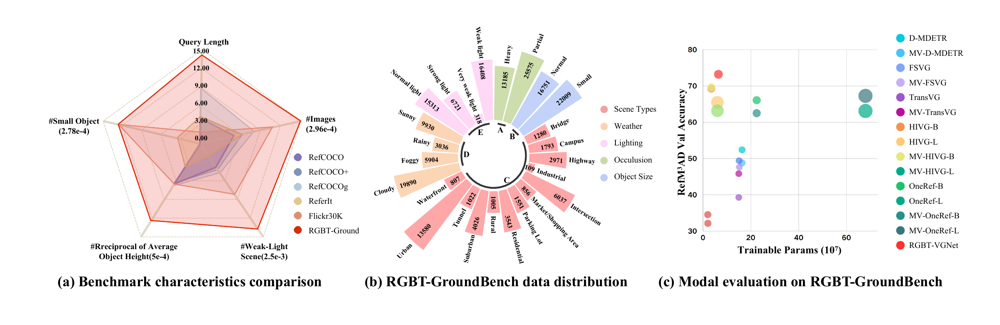
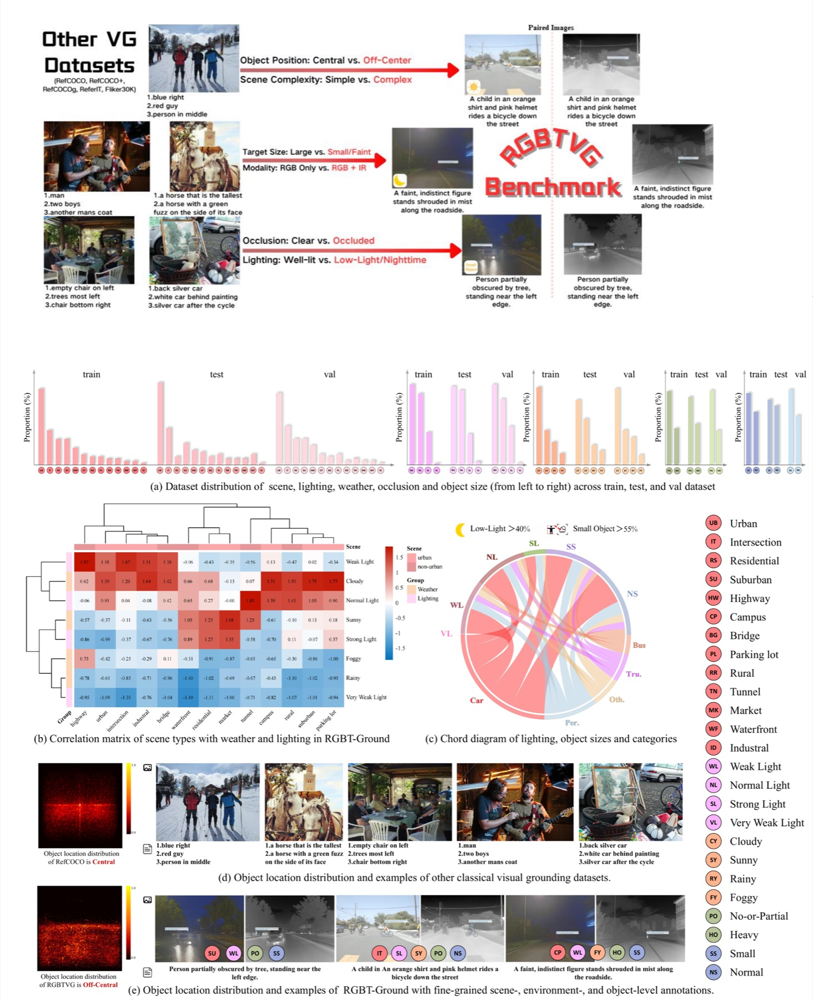
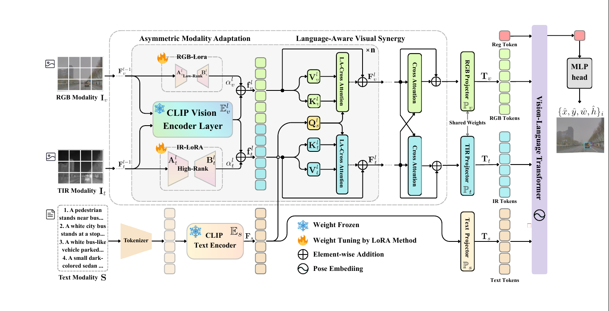

Current source release: **[v3.0](docs/RELEASE_v3.0.md)** — CLIP RGB/T optimization experiments, single-model late adaptation with EMA, evaluation and checkpoint utilities. See the release notes for resource requirements and measured results.

实验运行说明：**[v3.0 实验入口与运行说明](docs/Run_CLIP_Experiments_v3.0.md)**，包含主要入口、资源配置、训练、续训、评价及结果文件说明。

<div align="center">

<h1>RGBT-GroundBench</h1>
<h3>Visual Grounding Beyond RGB in Complex Real-World Scenarios</h3>

<p><strong>ECCV 2026</strong></p>
<p>
  <a href="https://github.com/Zhao-Tian-yi">Tianyi Zhao</a><sup>1,*</sup> &nbsp;&nbsp;
  <a href="https://github.com/crazyxiaoxi">Jiawen Xi</a><sup>1,*</sup> &nbsp;&nbsp;
  Linhui Xiao<sup>2</sup> &nbsp;&nbsp;
  Junnan Li<sup>1</sup> &nbsp;&nbsp;
  Xue Yang<sup>3</sup> &nbsp;&nbsp;
  Maoxun Yuan<sup>1,†</sup> &nbsp;&nbsp;
  Xingxing Wei<sup>1,†</sup>
</p>
<p>
  <sup>1</sup>Beihang University &nbsp;&nbsp;
  <sup>2</sup>Pengcheng Laboratory &nbsp;&nbsp;
  <sup>3</sup>Shanghai Jiao Tong University
</p>
<p><small><sup>*</sup>Equal contribution &nbsp;&nbsp; <sup>†</sup>Corresponding author</small></p>
<p>
<a href="https://arxiv.org/abs/2512.24561"></a>
<a href="https://github.com/crazyxiaoxi/RGBT-GroundBench"></a>
<a href="https://huggingface.co/datasets/JiawenXi/RGBT-Ground-Dataset"></a>
<a href="https://huggingface.co/JiawenXi/RGBT-Ground-Model"></a>
</p>

</div>

## Introduction

Visual grounding aims to localize an object described by natural language. Existing benchmarks, however, are predominantly built on RGB images collected under clean conditions. They offer limited coverage of the low illumination, adverse weather, occlusion, and small or distant objects that perception systems encounter in the real world.

**RGBT-GroundBench** extends visual grounding beyond RGB. It is the first large-scale benchmark for RGB-Thermal grounding in complex real-world scenarios, pairing natural-language expressions and target boxes with aligned RGB-TIR imagery and fine-grained condition labels. The benchmark further provides a unified protocol for fair comparison across **RGB**, **TIR**, and **RGB+TIR** inputs.

<p align="center">
  
  <br>
  <em>Benchmark characteristics, annotation distribution, and representative model performance on RGBT-GroundBench.</em>
</p>

| 21,535 | 38,760 | 13 | 11 |
|:---:|:---:|:---:|:---:|
| RGB-TIR pairs | Grounding instances | Scene categories | Evaluated models |

## What RGBT-GroundBench Provides

- **A challenging RGB-TIR benchmark.** More than 40K images from diverse real-world scenes, with a substantially higher proportion of low-light and small-object cases than classical visual grounding datasets.
- **Fine-grained condition annotations.** Each instance is characterized at three levels: scene type; illumination and weather; and object size and occlusion.
- **A unified evaluation protocol.** The same data splits and metrics support controlled comparison of RGB-only, TIR-only, and RGB+TIR grounding.
- **A broad empirical study.** Evaluation of 11 representative models exposes four underexplored challenges: sensitivity to scene complexity, severe low-light degradation, the robustness benefit of LoRA adaptation, and limitations of current multimodal LLMs.
- **A reproducible reference baseline.** RGBT-VGNet provides a simple, competitive design for language-guided and reliability-aware RGB-TIR fusion.

## Dataset

RGBT-GroundBench is built from FLIR, M3FD, and MFAD. Each retained sample contains paired RGB-TIR images, a referring expression, a target bounding box, and condition labels. Its targets are frequently small, occluded, and off-center, while its scenes span daylight, nighttime, weak illumination, and adverse weather.

<p align="center">
  <a href="assets/dataset_overview.jpg">
    
  </a>
  <br>
  <em>Overview of RGBT-GroundBench. Click the figure to view it at full resolution.</em>
</p>

### Statistics

| Sub-dataset | Instances | Train | Val | Test | TestA | TestB | TestC | Source |
|---|---:|---:|---:|---:|---:|---:|---:|---|
| RefFLIR | 9,712 | 7,000 | 608 | 2,104 | 837 | 640 | 968 | FLIR |
| RefM3FD | 7,548 | 3,604 | 168 | 3,776 | 1,232 | 1,094 | 1,848 | M3FD |
| RefMFAD | 21,500 | 16,000 | 1,256 | 4,244 | 789 | 2,452 | 2,544 | MFAD |
| **Total** | **38,760** | **26,604** | **2,032** | **10,124** | **2,858** | **4,186** | **5,360** | **All** |

`TestA`, `TestB`, and `TestC` are condition-specific subsets of the test set. See the paper for their precise definitions and the original dataset citations.

### Download

| Resource | Link |
|---|---|
| All resources | [RGBT-Ground-Dataset on Hugging Face](https://huggingface.co/datasets/JiawenXi/RGBT-Ground-Dataset) |
| RefFLIR | [Annotations](https://huggingface.co/datasets/JiawenXi/RGBT-Ground-Dataset/resolve/main/ann_flir.tar) · [Images](https://huggingface.co/datasets/JiawenXi/RGBT-Ground-Dataset/resolve/main/data_flir.tar) |
| RefM3FD | [Annotations](https://huggingface.co/datasets/JiawenXi/RGBT-Ground-Dataset/resolve/main/ann_m3fd.tar) · [Images](https://huggingface.co/datasets/JiawenXi/RGBT-Ground-Dataset/resolve/main/data_m3fd.tar) |
| RefMFAD | [Annotations](https://huggingface.co/datasets/JiawenXi/RGBT-Ground-Dataset/resolve/main/ann_mfad.tar) · [Images](https://huggingface.co/datasets/JiawenXi/RGBT-Ground-Dataset/resolve/main/data_mfad.tar) |

## Reference Baseline: RGBT-VGNet

Motivated by the benchmark findings, we introduce **RGBT-VGNet**, a reference baseline that adapts an RGB-pretrained vision-language model to cross-spectral grounding and fuses the two modalities according to their reliability.

- **Asymmetric Modality Adaptation (AMA)** assigns higher-rank LoRA adaptation to the TIR branch, reflecting the larger domain gap from RGB pretraining.
- **Language-Aware Visual Synergy (LAVS)** lets the referring expression guide cross-modal interaction and retain target-relevant evidence.
- **Tri-Prior Fusion (TPF)** combines RGB and TIR features using modality, illumination, and language-aware reliability cues.

<p align="center">
  
  <br>
  <em>Architecture of RGBT-VGNet.</em>
</p>

## Getting Started

### Installation

```bash
git clone https://github.com/crazyxiaoxi/RGBT-GroundBench.git
cd RGBT-GroundBench

conda env create -f environment_full.yml
conda activate rgbtvg
```

For a lighter pip-based setup:

```bash
conda create -n rgbtvg python=3.9
conda activate rgbtvg
pip install -r requirements.txt
```

### Data Preparation

Download the images and annotations from the links above, then set the corresponding dataset paths in the training and evaluation scripts. By default, the code expects visual grounding data under:

```text
../dataset_and_pretrain_model/datasets/VG
```

### Legacy MMVG/LAVS (`old_model` branch)

The `old_model` branch provides the original `MMVG` model with LAVS fusion and
is paired with the released checkpoints under `result/MMVG`. Use these entry
points when reproducing the legacy results; they do not construct the newer
`MMVGFusion/IAFv3` model:

```bash
# evaluate the released MMVG checkpoint(s)
bash script_eval/MMVG/all_eval.sh

# retrain MMVG/LAVS from the released MMVG pretraining checkpoint
bash script_train/MMVG/train_all.sh
```

For a single dataset, set `DATASET` for evaluation or use the dataset-specific
training wrapper, for example `bash script_train/MMVG/rgbtvg_flir/train.sh`.

### Optional InfMAE thermal frontend

The direct-InfMAE experiments keep the upstream InfMAE code and its checkpoint
out of this repository. Clone the upstream project at `./InfMAE`, apply the
included runtime compatibility patch, and place the released `InfMAE.pth` at
`InfMAE/InfMAE.pth` before launching an `InfMAEDirectV2` or `InfMAEA5Bridge`
experiment:

```bash
git clone https://github.com/liufangcen/InfMAE.git InfMAE
git -C InfMAE apply ../patches/infmae_runtime_compatibility.patch
```

### Training

RGBT-VGNet uses **IAFv3 RGB-T fusion** and the multi-stage HiLoRA schedule by default. Train it sequentially on all three benchmark datasets:

```bash
bash script_train/RGBT_VGNet/train_all.sh
```

To train on one dataset only:

```bash
bash script_train/RGBT_VGNet/ref_m3fd/train.sh
```

Each dataset script initializes from the released MMVG pretraining checkpoint, then runs warm-up and HiLoRA stages 1–3. Image size, batch size, GPU selection, learning schedule, and checkpoint path can be overridden through the environment variables defined at the top of each script; the released model configuration remains fixed to RGB-T input and IAFv3 fusion.

### Evaluation

```bash
bash script_eval/RGBT_VGNet/evaluate_all.sh
```

This entry point runs inference and reports grounding accuracy across the supported datasets and evaluation settings.

### Visualization

```bash
bash script_visualize/all/run_all_rgbt_vgnet_tests.sh
```

## Repository Structure

```text
RGBT-GroundBench/
├── data_pre/              # Data preprocessing scripts
├── datasets/              # Dataset definitions and loaders
├── models/                # Model architectures
├── script_train/          # Training scripts
├── script_eval/           # Evaluation scripts
├── script_visualize/      # Visualization tools
├── train_val/             # Training and validation utilities
├── utils/                 # Helper functions
├── environment_full.yml   # Reproducible Conda environment
├── requirements.txt       # Pip dependencies
└── README.md
```

## Citation

If this benchmark or codebase is useful in your research, please cite our paper:

```bibtex
@inproceedings{zhao2026rgbtgroundbench,
  title     = {RGBT-GroundBench: Visual Grounding Beyond RGB in Complex Real-World Scenarios},
  author    = {Zhao, Tianyi and Xi, Jiawen and Xiao, Linhui and Li, Junnan and Yang, Xue and Yuan, Maoxun and Wei, Xingxing},
  booktitle = {European Conference on Computer Vision (ECCV)},
  year      = {2026}
}
```

## License

This repository is released for academic research. The source datasets remain subject to their respective licenses; please consult the original dataset pages before redistribution or commercial use.

## Contact

For questions, please open a GitHub issue or contact the authors using the email addresses provided in the [paper](https://arxiv.org/abs/2512.24561).
