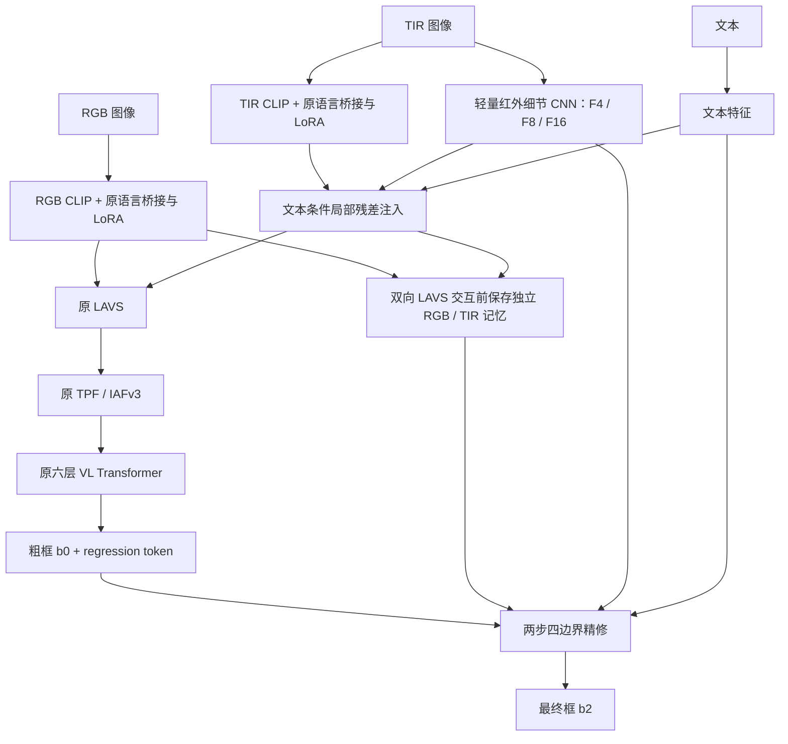

# CLIP / RGB-T 模型优化聊天历史归档

保存日期：2026-10-20（Asia/Shanghai）。

项目：`/dataset/zhanggongcai/RGBT/RGBT-GroundBench`。

## 保存范围与原文说明

本文件将本次聊天中当前可见的用户消息、最近几轮助手完整答复、较早工作过程的上下文摘要，以及现有的 2026-10-08 会话记录合并为一个 Markdown 文件。

- 用户业务消息按当前可见顺序保存，保留重复追问；重复的 IDE 元信息单独说明。
- 当前仍可见的最近几轮助手答复按原文保存。
- 较早助手答复已经经过上下文压缩，不能完整逐字恢复；补记部分明确标为“摘要”，不冒充逐字聊天记录。
- 工具调用的全部原始输出未逐条复制，实验依据通过本地文件链接保留。
- 附录中的旧会话记录本身也是研究过程摘要，不是逐字转录；其中“当前”“最新”等措辞均指其原归档日期 2026-10-08。
- 本次保存只新增本文件，不启动训练，不改模型、权重、数据、历史日志或既有归档。

## 一、用户消息记录：读取历史后至最近进度查询

以下为当前可见的用户业务消息，按出现顺序编号。部分消息未附独立时间戳，因此不补造逐条日期。

### 用户消息 01

> @docs/CLIP_MODEL_OPTIMIZATION_SESSION_SUMMARY_2026-10-08.md读取历史对话记录

### 用户消息 02

> LAVS、TPF / IAFv3 和六层 VL Transformer在模型结构中结构是咋样的和分别起到什么作用

### 用户消息 03

> 对于相关领域进展，lavs应该是几年前的融合手段，目前26年对于模态之间融合有更先进的的方法吗？，检索学术文献

### 用户消息 04

> 另外他本质是一种模态融合手段，可以检索一下当前的一些先进的跨模态方法

### 用户消息 05

> 这个lavs我需要换成其他的融合方法作为我的创新点，我需要帮我根据当前先进的融合手段去改进测试效果

### 用户消息 06：对替换范围的明确选择

此前的选项问题：

> LAVS 包含 CLIP 内部的文本引导和输出后的 RGB/TIR 双向交互。这次替换哪一部分？我建议先替换外部双向交互，保留已有语义路径，便于定位收益来源。

用户选择：

> 先替换外部双向交互（建议）

### 用户消息 07

> 继续

### 用户消息 08

> 你是怎么做的？

### 用户消息 09

> 目前效果

### 用户消息 10

> 这个模型结构里也有红外专门的小模块吧？

### 用户消息 11

> 现在训练状态如何

### 用户消息 12

> 现在呢？

随该消息提供的 IDE 活动文件与打开标签：

`output_clip_structure_control/2026-10-05_c1_detail_boundary/formal/c1_seed15/log.txt`。

### 用户消息 13

> 如果继续优化模型性能

### 用户消息 14

> 那开始启动训练

### 用户消息 15

> 现在情况

### 用户消息 16

> 我需要你看下这个软空间融合的测试集效果

### 用户消息 17

> 原C1是什么？

### 用户消息 18

> 现在其他几组实验的效果

### 用户消息 19

> 现在效果

从本条开始，多次状态查询附带的 IDE 活动文件与打开标签均为：

`output_clip_structure_control/2026-10-05_c1_detail_boundary/status.json`。

该文件属于 10 月 5 日的旧结构对照，不代表后续 10 月 18 日实验的实时状态。

### 用户消息 20

> 后续如何继续优化

### 用户消息 21

> 后续如何继续优化

### 用户消息 22

> 那我需要你开始优化，保证模型优化精度提升，并且我vscode关了也能在后台训练

### 用户消息 23

> 当前效果

### 用户消息 24

> 继续

### 用户消息 25

> 当前效果

### 用户消息 26

> 继续

### 用户消息 27

> 该如何继续优化

### 用户消息 28

> 继续优化吧，之前没用的权重删掉别浪费内存

## 二、较早助手讨论与执行过程补记（摘要，非逐字答复）

### 2.1 研究目标和替换边界

用户希望通过跨模态融合改进 RGB-T 文本指代定位模型，并形成可验证的创新点。已确认先改 CLIP 输出之后的 RGB/TIR 外部双向交互，保留编码器内部文本引导、TPF / IAFv3 和六层 VL Transformer 等原有语义路径。

此前讨论过近期跨模态融合文献，随后探索了局部交互、文本条件交互、软空间融合和门控等实现。这里记录讨论主线，不补造已经不可见的逐篇论文解读或原始检索答复；本次存档也没有重新检索文献。

### 2.2 C1、红外小模块和原有结构

当前对照中的“原 C1”指正式结构对照的 C1，而不是早期几何实验中也叫 C1 的 safe-crop 模型。正式 C1 seed13 使用零基 epoch100 的冻结权重。

保留的主干包括 CLIP ViT-B/16、RGB/TIR 两路 LoRA、内部文本引导、外部双向交互、IAFv3、六层 VL Transformer 和框预测头。历史实现中另有红外细节 CNN、局部注入和边界精修器；这些属于此前的结构改进分支，原 C1 中对应开关关闭，不能把这些分支的结果与 C1 混为一谈。

正式 C1 冻结参考：

- [C1 seed13 权重](../output_clip_structure_control/2026-10-05_c1_detail_boundary/frozen/c1_seed13.pth)。
- [正式模型登记](../output_clip_structure_control/2026-10-05_c1_detail_boundary/selected_models.json)。

### 2.3 外部融合替换的几轮探索

1. 外部局部交互与文本条件局部交互：完成对应实验，验证集未超过正式 C1，未据此证明结构收益。
2. 软空间融合：对全局门控、文本全局门控和文本软空间融合做对照。用户明确要求后，对软空间融合的验证选定 epoch83 做过测试。
3. 可靠性门控探索：比较方向门控、可靠性门控和可靠性软空间融合，各 20 轮；正式选择均保留初始化 C1，未达到扩展多 seed 的门槛。
4. 为区分新增门控、辅助损失与原交互层续训的作用，又完成最新 A/B/C/D 四组清洁数据对照，各 20 轮。

软空间融合的历史测试结果（seed13，验证选定 epoch83）：

| 模型 | Test Acc@0.5 | Test Acc@0.7 | Test mIoU |
|---|---:|---:|---:|
| 正式 C1 seed13 | 71.768% | 52.757% | 61.027% |
| 文本软空间融合 | 72.909% | 53.470% | 61.333% |

软空间融合相对 C1 的三项变化约为 +1.141、+0.713、+0.306 个百分点，但对应图像配对 bootstrap 区间均包含 0；弱光组 mIoU 约下降 1.211 个百分点。该结果属于单 seed 的历史测试观察，不能直接视为稳定、全面的融合提升。

证据：[软空间融合测试报告](../output_clip_lavs_control/2026-10-13_soft_spatial_exchange/user_requested_test_report.json)。

### 2.4 最新 A/B/C/D 对照的实施

实验目录：`output_clip_lavs_control/2026-10-18_clean_joint_control/`。

| 组别 | 实验含义 |
|---|---|
| A：`a_clean_full` | 方向门控，不加合成退化，保留原有损失，原模型参数冻结 |
| B：`b_clean_box` | 在 A 的基础上保留框定位损失与相同门控约束，关闭原有其他辅助损失 |
| C：`c_joint_box` | 在 B 的基础上联合微调原外部交互的 Q/K/V/O 投影 |
| D：`d_c1_continue` | 不增加新门控，按与 C 匹配的投影范围、数据、框损失和轮数继续训练 C1 |

四组均从匹配的正式 C1 seed13 出发，每组 20 轮；名义有效 batch96；新模块学习率 `1e-4`，原交互投影学习率 `1e-5`。该阶段是从已训练 C1 出发的受控续训，不是从公共初始化完成的正式三 seed 重训。

训练队列采用独立后台控制器，保留不可变源码快照、配方、SHA256、原子状态记录、优化器、调度器及各 rank 随机状态。最新这轮预检与相关检查记录为 66 项测试通过；四组真实双 GPU 更新、可训练参数范围与恢复边界均做过检查。

模型选择始终采用“首次严格达到验证 Acc@0.5 最大值”的规则，并包含训练前 C1 作为 epoch -1 保底。四组实际训练均未严格超过 C1，因此最终登记的最佳权重都保留训练前 C1。其他指标必须来自同一轮，不能拼接不同 epoch 的峰值。

四组各 20 轮、合计 80 轮已正常完成，状态为 `gate_not_passed`，推荐模型为 `c1`；没有触发 seed14/15 扩展。后续测试是用户另外明确要求的末轮诊断。

证据：[训练状态](../output_clip_lavs_control/2026-10-18_clean_joint_control/status.json)、[训练报告](../output_clip_lavs_control/2026-10-18_clean_joint_control/report.json)、[预注册配方](../output_clip_lavs_control/2026-10-18_clean_joint_control/preregistration.json)。

### 2.5 权重清理

用户已明确授权清理无用权重。2026-10-18 的清理删除 18 个文件，释放 31,035,783,542 bytes，约 28.90 GiB 磁盘空间；其中包括与冻结模型重复的正式 best 和已结束、未通过对照的末轮训练状态。

冻结模型、正式 C1 三个 seed、消融模型、预训练资源、数据、源码快照、日志和评估结果均保留。最新 A/B/C/D 的末轮权重未在该次清理中删除，并已用于后续用户要求的测试。旧 `formal/*/best_checkpoint.pth` 的部分重复文件已经删除，继续评估 C1 时应使用 `frozen/*.pth`。

证据：[2026-10-18 清理清单](../output_checkpoint_cleanup/2026-10-18_redundant_formal/cleanup_manifest.json)。这里释放的是磁盘空间，不等同于运行时内存或显存。

## 三、最近几轮完整问答（当前可见原文）

### 用户消息 29：查询当前效果

> 现在效果如何

该消息附带的 IDE 活动文件仍为：`output_clip_structure_control/2026-10-05_c1_detail_boundary/status.json`。

### 助手答复 29

**最新四组实验均已正常完成，每组20轮，共80轮；主指标 Acc@0.5 仍未超过原 C1，目前保留 C1。**

下表是**验证集**结果：各实验取实际训练后 Acc@0.5 最佳轮次，其他指标来自同一轮。

| 方案 | Acc@0.5 ↑ | Acc@0.7 ↑ | mIoU ↑ |
|---|---:|---:|---:|
| **原 C1** | **78.289%** | **58.224%** | 66.182% |
| A：方向门控＋原有损失 | 78.125% | 58.059% | 66.198% |
| B：方向门控＋框定位损失 | 78.125% | **58.224%** | 66.198% |
| C：门控与原交互投影联合训练 | 77.961% | 58.059% | **66.722%** |
| D：原 C1 继续训练对照 | 78.125% | 57.401% | 66.680% |

关键发现是：**C 的 mIoU 比原 C1 提升了约0.54个百分点，但 Acc@0.5 下降约0.33个百分点。** 同时，单纯继续训练 C1 的 D 也提升了约0.50个百分点 mIoU，因此目前不能把改善主要归因于新融合模块。

本轮未达到预设提升条件，已正常结束，未继续多种子复验，也未新增测试集评估。

你当前打开的是10月5日旧状态；最新记录在 [10月18日实验报告](/dataset/zhanggongcai/RGBT/RGBT-GroundBench/output_clip_lavs_control/2026-10-18_clean_joint_control/report.json)。

归档补注：以上“未新增测试集评估”指本次答复当时的状态；紧接着用户要求测试，后续已经完成。A/B 的最佳训练轮次为零基 epoch0，C/D 为零基 epoch14；这张表没有把初始化保底 C1 当作实际训练后的模型。

### 用户消息 30：明确要求测试集评估

> 我需要你去得到测试集的效果

### 助手执行过程中的可见说明

> 我会检查这轮模型保存的权重，用固定的测试集评估流程运行，并标明每组实际评估的训练轮次。

> 发现一个需要说明的区别：四组按验证集选出的 `best` 都是训练前的 C1，实际训练权重目前只保留了第20轮。我会测试这四组第20轮权重，并重新评估原 C1 作对照；上一条表格中的“训练后最佳轮次”没有单独保存，不能直接拿来测试。

> 评估已在独立后台会话中启动：原 C1 加 A/B/C/D 四组，共5个模型。每个模型会先复核验证集是否与训练日志一致，再统计测试集的 Acc@0.5、Acc@0.7 和 mIoU。

执行事实补注：初次 tmux 启动在产生状态文件前退出，没有产生评估结果；随后改由工具执行会话完成全部 5 组评估。启动尝试和实际执行方式分别保存在 `user_requested_test_epoch20/launch_attempt1.json` 与 `launch.json`。以上保留当时过程说明，不将第一次启动表述为最终成功的执行方式。

> 原 C1 的测试结果已复现：Acc@0.5 为 **71.768%**、Acc@0.7 为 **52.757%**、mIoU 为 **61.027%**，与历史记录一致。正在评估四组训练后的权重，已完成的验证集复核也与训练日志一致。

> A、B、C 已完成测试。联合训练 C 的 Acc@0.5 为 **72.576%**，比 C1 高 **0.808 个百分点**；Acc@0.7 和 mIoU 也有提高。正在完成 D（原 C1 继续训练）的对照评估，随后会比较新门控与单纯续训的收益。

### 助手答复 30

**测试已完成，共2104条样本。** A/B/C/D 均测试了 seed13 的**第20轮权重**；上一条展示的“训练后最佳验证轮次”未单独保存。

| 方案 | 测试 Acc@0.5 ↑ | 测试 Acc@0.7 ↑ | 测试 mIoU ↑ |
|---|---:|---:|---:|
| 原 C1 | 71.768% | 52.757% | 61.027% |
| A：方向门控＋原有损失 | 72.053% | 53.850% | 61.093% |
| B：方向门控＋框定位损失 | 71.911% | 53.850% | 61.148% |
| C：门控与原交互投影联合训练 | 72.576% | 54.420% | 61.424% |
| **D：原 C1 继续训练** | **72.814%** | **54.468%** | **61.580%** |

**D 表现最好**：相较原 C1，Acc@0.5 提升 **1.046个百分点**，mIoU 提升 **0.553个百分点**。C 也有提升，但仍低于 D，当前结果尚未支持新增门控带来额外收益。

这些是单种子末轮测试结果；按原定验证集选模规则，正式模型仍保留 C1。

[完整测试报告](/dataset/zhanggongcai/RGBT/RGBT-GroundBench/output_clip_lavs_control/2026-10-18_clean_joint_control/user_requested_test_epoch20/report.json)

### 用户消息 31：请求导师周报段落

> 你能用一段话总结我当前的进度吗，用于给导师周报汇报

### 助手答复 31

本周围绕基于 CLIP 的 RGB-T 文本指代定位模型，开展了外部 LAVS 融合模块的改进，探索软空间融合、方向门控及融合层联合微调，并完成四组各20轮的对照实验和测试集评估。在 seed13 的第20轮测试中，原 C1 继续微调的效果最好，Acc@0.5 从71.77%提升至72.81%，mIoU 从61.03%提升至61.58%；加入门控的联合微调方案分别达到72.58%和61.42%，尚未超过单纯续训对照，因此目前还不能确认新融合模块具有额外收益。同时，已完善后台训练与实验记录，并清理冗余权重。由于验证集主指标仍未超过原 C1，目前保留原模型，后续重点分析验证集与测试集表现差异，并通过多随机种子实验验证改进的稳定性。

归档补注：以上“本周”保留当时答复措辞；它是周报草稿。文中的“后续”属于计划，不表示已经执行额外 seed 训练。

### 用户消息 32：请求本次归档

> 你先宝存我和你聊天的历史记录成一个。md

### 助手归档过程说明

> 我会把当前可见的聊天记录整理成一个 Markdown 文件，保存在项目的 `docs` 目录，并注明因上下文压缩而无法逐字恢复的部分。

> 我会把现有的10月8日会话归档一并收录，再补上后续实验进展、测试结果和最近几轮完整问答。早期已被压缩的回复会标为摘要，避免与原文混淆。

## 四、截至本次归档的结果核对与续接入口

本节为保存时依据本地文件核对的状态，不是新做的一轮训练或评估。

### 4.1 必须分开的三种结果

1. **正式选择结果**：最新四组的验证最佳均为 epoch -1，即初始 C1，推荐模型没有替换。
2. **训练后最佳验证轮次**：A/B 为 epoch0，C/D 为 epoch14；记录可从训练日志与 `report.json` 查到，但对应训练后最佳权重未单独保存。
3. **用户要求的测试结果**：四组统一使用末轮 epoch19，即第20轮；原 C1 使用其正式冻结 epoch100。测试前已固定全部待评估权重，没有根据测试结果重新挑 epoch。

最新末轮模型的验证和测试对应同一 checkpoint：

| 模型 | 零基 epoch | Val Acc@0.5 | Val Acc@0.7 | Val mIoU | Test Acc@0.5 | Test Acc@0.7 | Test mIoU |
|---|---:|---:|---:|---:|---:|---:|---:|
| 原 C1 seed13 | 100 | 78.289% | 58.224% | 66.182% | 71.768% | 52.757% | 61.027% |
| A：方向门控＋原有损失 | 19 | 77.138% | 58.717% | 66.321% | 72.053% | 53.850% | 61.093% |
| B：方向门控＋框定位损失 | 19 | 77.632% | 58.882% | 66.403% | 71.911% | 53.850% | 61.148% |
| C：联合微调 | 19 | 77.632% | 57.237% | 66.706% | 72.576% | 54.420% | 61.424% |
| D：C1 继续微调 | 19 | 78.125% | 57.401% | 66.675% | 72.814% | 54.468% | 61.580% |

验证集 608 条表达，测试集 2104 条表达、1013 张图。每项测试均完成样本索引检查、验证结果复核与 checkpoint 身份核对。

C 相对 D 的测试变化为 Acc@0.5 -0.238、Acc@0.7 -0.048、mIoU -0.156 个百分点。因此应分别报告续训收益和新融合机制贡献；不能把 C 相对原 C1 的全部改善都归因于门控。

测试报告包含 5000 次按图像配对 bootstrap。该统计以本次单 seed 模型为条件，不能代替多 seed 的训练稳定性证据。已经观察过的测试集不能再当成未见测试数据。

### 4.2 重要文件

- [最新训练状态](../output_clip_lavs_control/2026-10-18_clean_joint_control/status.json)：四组训练正常结束，`gate_not_passed`。
- [最新训练报告](../output_clip_lavs_control/2026-10-18_clean_joint_control/report.json)。
- [用户要求的测试登记](../output_clip_lavs_control/2026-10-18_clean_joint_control/user_requested_test_epoch20/registration.json)：测试前固定的五个 checkpoint、SHA256 和评估规则。
- [测试完成状态](../output_clip_lavs_control/2026-10-18_clean_joint_control/user_requested_test_epoch20/status.json)：`completed`，5/5 完成。
- [完整测试报告](../output_clip_lavs_control/2026-10-18_clean_joint_control/user_requested_test_epoch20/report.json)：整体、分组及配对比较。
- [测试与验证指标 CSV](../output_clip_lavs_control/2026-10-18_clean_joint_control/user_requested_test_epoch20/metrics.csv)。
- [训练源码 SHA256 清单](../output_clip_lavs_control/2026-10-18_clean_joint_control/source_manifest.json)。
- [正式 C1 与早期结构模型登记](../output_clip_structure_control/2026-10-05_c1_detail_boundary/selected_models.json)。
- [10 月 18 日权重清理清单](../output_checkpoint_cleanup/2026-10-18_redundant_formal/cleanup_manifest.json)。

后续工作尚需验证：验证集与测试集差异的原因、原 C1 续训的多 seed 稳定性，以及新融合结构相对匹配续训对照的实际贡献。目前未新增这些实验，也未承诺能够保证精度提升。

## 五、2026-10-08 旧会话归档全文

下方收录原文件 `docs/CLIP_MODEL_OPTIMIZATION_SESSION_SUMMARY_2026-10-08.md` 的全文。该部分记录的是 10 月 8 日及以前的历史状态；后续模型、实验完成情况和权重清理变化，以本文件前四部分及对应最新报告为准。原文件保留不变。

<!-- BEGIN ARCHIVED 2026-10-08 SESSION SUMMARY -->

# CLIP 模型优化会话记录（截至 2026-10-08）

记录日期：2026-10-08，北京时间。项目：`RGBT-GroundBench`，数据集：RefFLIR / `rgbtvg_flir`。

本文整理本轮会话中的研究目标、设计决策、实施结果、模型回退与权重清理，便于后续继续工作。它是研究过程摘要，不是逐字聊天转录。数值以现有实验日志、冻结模型登记及评估报告为依据；已完成、未完成和待验证内容分别注明。

## 1. 当前状态与最重要的结论

当前代码已恢复到 **C1 / 红外细节与边界精修联合方案 V1**，保留原来的 LAVS、TPF / IAFv3 和六层 VL Transformer。V2 的任务分工路由与三阶段解码代码已归档，V2 训练队列已停止。

- V1 的 3 次探索训练和 8 次正式训练均已完成；8 个正式模型均已登记、冻结并完成验证和测试。
- Seed14 联合方案测试结果确实高于同 seed 的 C1：Acc@0.5 **74.00%**、Acc@0.7 **55.51%**、mIoU **62.35%**。
- 三 seed 平均测试收益较小：Acc@0.5 **+0.158**、Acc@0.7 **+0.475**、mIoU **+0.054** 个百分点；验证集三项平均指标均下降。
- 因此，Seed14 的改善可以如实报告，但尚不能表述为稳定、显著且全面的结构提升，也未达到三 seed 平均 Acc@0.5 提升至少 1 个百分点的继续投入目标。
- V2 已完成的两组固定采样实验明显低于 C1；自适应共享路由仅完成 38 轮。按用户要求停止并回退，没有完成原计划的四组筛选和后续 seed14、15。
- 2026-10-08 已清理 20 个不重要的权重文件，合计 **29,651,669,941 bytes，约 27.62 GiB**。正式最佳模型、冻结模型、已有测试模型、日志与源码备份保留。
- 本次归档只新增这份 Markdown，没有重新启动训练、修改模型实现或操作 GitHub 远端。

## 2. 用户目标与持续约束

用户希望基于当前数据集发表论文，要求模型在验证集和测试集上改善，同时有可以通过实验验证的结构创新。研究主线逐步从 InfMAE 替换红外前端，转向保留 CLIP 的语义优势并改善红外细节与定位。

已明确的约束：

1. 沿用现有数据、标注和预训练资源；不把新增模块或复杂度直接等同于创新。
2. 固定可复核的 C1 参考，使用匹配初始化、配方和 seed 做对照。
3. Acc@0.5、Acc@0.7、mIoU 均报告同一个验证选定 checkpoint，不能拼接不同 epoch 的峰值。
4. 关注小目标、弱光和高 IoU 定位精度，不能只看整体 Acc@0.5。
5. 训练和选择使用训练集、验证集；测试集用于冻结后的报告。已经查看过的测试结果不能再当成未见数据的证据。
6. 后续启动训练时，整个队列应脱离 VS Code 和 SSH，训练主机正常运行时关闭编辑器、终端或断开连接也应继续运行。
7. 保留有用的代码快照、论文对照模型、消融模型和实验记录；仅清理明确放弃、已结束且不再需要的权重。

用户曾要求将 CLIP 改进发布到 `https://github.com/zgc2916/rgb_in_text.git` 的 main 分支并设置 `v2.0` 标签，同时编写训练教学文档。本记录不据此推断远端当前发布状态；这里的研究结构 **V2** 也不应与 Git 标签 **v2.0** 混为一谈。

## 3. 前期诊断：为什么先修训练几何，再改模型

### 3.1 InfMAE 与 CLIP 的路线调整

早期 InfMAE 尝试包括低学习率续训、权重平均、回归损失调整、局部中心修正、语义迁移和增强对照。部分验证结果有小幅波动，但缺少稳定的跨 seed 收益。后续完整 CLIP 对照提供了更强的语义与测试基线，研究主线改为 CLIP，InfMAE 保留为研究支线。

前期测试对照：

| 模型 | checkpoint epoch | Test Acc@0.5 | Test Acc@0.7 | Test mIoU |
|---|---:|---:|---:|---:|
| 本地 InfMAE A5-F2 | 94 | 69.20% | 49.52% | 58.78% |
| CLIP batch6 | 95 | 71.67% | 53.61% | 61.01% |
| CLIP batch12 | 111 | 72.20% | 53.61% | 60.91% |

完整早期过程见 [InfMAE 会话记录](../InfMAE_CHAT_SESSION_2026-09-27.md) 和 [前期模型优化总结](../CHAT_AND_MODEL_OPTIMIZATION_SUMMARY.md)。

### 3.2 batch12 对照

每卡 batch 从 6 改到 12，梯度累积从 8 改到 4；两张 GPU 下名义有效 batch 都是 96。单次对比损失的本卡候选数从 6 增至 12。梯度累积不会把不同 microbatch 的候选矩阵拼在一起。

验证集 Acc@0.5 从 76.151% 提高到 77.961%，但测试集 Acc@0.5 只净增 11 个样本，Acc@0.7 持平，mIoU 略降。这属于完整 microbatch 配方对照，不能把收益全部归因于候选数。

详见 [batch12 会话总结](CLIP_BATCH12_SESSION_SUMMARY_2026-10-04.md)。

### 3.3 “训练目标的几何问题”具体是什么

原 `RandomSizeCrop` 的裁剪接受判断存在坐标混用：目标中心 X 与 crop 的 top 比较，中心 Y 与 left 比较；同时未检查右、下边界及目标完整保留。随后框被裁到图像边界，可能生成截断目标，甚至零宽或零高框。

目标保留裁剪改为检查完整 xyxy 框与四条裁剪边界，采样失败时保留完整图像。GT 只参与训练增强与监督，不进入推理。

固定抽样 512 条训练表达、seed13 的几何审计：

| 增强 | 空框 | 截断框，含空框 | 短边 <4 px | 短边 <8 px |
|---|---:|---:|---:|---:|
| 原增强 | 21 | 50 | 143 | 266 |
| 完整目标保留裁剪 | 0 | 0 | 119 | 249 |
| 目标保留裁剪 + 8 px 尺度保护 | 0 | 0 | 8 | 138 |

这些是一次固定抽样的统计，不代表每个 epoch 的精确比例。原始 7000 条训练标注未发现整数宽高非正目标，审计中的空框由增强产生。证据见 [增强几何审计](../output_infmae_a5f2_target_crop/2026-10-03_audit_only/augmentation_audit.json)。

### 3.4 8 像素尺度保护及最终取舍

8 px 尺度保护通过 GT 短边限制训练缩小倍率，减少增强后极小目标；它不会修改 GT 来假装扩大目标，也不能保证所有目标最终达到 8 px。原图目标即使缩放到允许的最大尺度仍可能更小。

三组匹配训练均完成 120 轮，seed13；表中验证与测试对应各自同一个验证选定模型：

| 方案 | epoch | Val Acc@0.5 | Val Acc@0.7 | Val mIoU | Test Acc@0.5 | Test Acc@0.7 | Test mIoU |
|---|---:|---:|---:|---:|---:|---:|---:|
| 原 batch12 增强 | 111 | 77.96% | 56.25% | 65.79% | 72.20% | 53.61% | 60.91% |
| 目标保留裁剪，尺度保护 0 | 78 | 78.62% | 57.57% | 66.07% | 73.24% | 53.94% | 61.75% |
| 目标保留裁剪 + 8 px 保护 | 98 | 79.77% | 56.25% | 65.99% | 71.82% | 52.95% | 60.95% |

8 px 保护改善了部分几何统计和验证 Acc@0.5，但同 checkpoint 的验证 Acc@0.7 下降，测试三项低于仅裁剪方案。后续 C1 配方采用 **目标保留裁剪、尺度保护 0**。

证据：[几何对照汇总](../output_clip_geometry_control/2026-10-05_seed13_b12_a4/comparison.json)、[裁剪测试报告](../output_clip_geometry_test/2026-10-05_seed13_safe_crop_epoch78/summary.json)、[8 px 保护测试报告](../output_clip_geometry_test/2026-10-05_seed13_safe_crop_floor8_epoch98/summary.json)。

## 4. 必须区分的两类 C1

“C1”在会话中用于两种相关但不同的实验身份，后续引用需带上来源、seed 和 epoch。

| 身份 | 用途 | 来源 | epoch |
|---|---|---|---:|
| 早期几何 C1，safe_crop seed13 | V1 探索续训来源、几何改进参考 | `output_clip_geometry_test/2026-10-05_seed13_safe_crop_epoch78/selected_model_only.pth` | 78 |
| 正式 C1 seed13 | 同公共初始化的结构对照 | V1 `frozen/c1_seed13.pth` | 100 |
| 正式 C1 seed14 | 与联合 seed14 匹配比较 | V1 `frozen/c1_seed14.pth` | 102 |
| 正式 C1 seed15 | 与联合 seed15 匹配比较 | V1 `frozen/c1_seed15.pth` | 77 |

早期几何 C1 的 73.24% / 53.94% / 61.75% 测试结果不属于新增结构，也不能替代正式 C1 seed13 的结果。正式训练使用早期 C1 配置中的公共 MMVG 初始化，从头重置优化器和 scheduler，并非从 epoch78 继续训练全部参数。

本地匹配对照也不能直接称为作者完整配方或作者权重的严格复现。已有历史记录引用论文测试 Acc@0.5 72.43%、Acc@0.7 53.85%；论文数字与本地各类 C1 的身份需分别标明。

## 5. V1：红外细节补偿与边界定位联合方案

### 5.1 设计动机与当前结构

CLIP ViT-B/16 在 224 输入下，第 1、4、8、12 层 patch 特征均为 14×14。它们提供不同深度的语义，但没有更高空间分辨率。因此新增红外旁路，补充局部对比、轮廓及小目标结构，并把融合前的定位证据送到边界精修器。

**V1 保留原论文后端三个主要模块。** 新增模块承担红外细节补偿和定位精修，LAVS、TPF / IAFv3、六层 VL Transformer 仍承担原来的语义交互和粗定位。这也是用户后续提出“创新不足”的原因之一。

### 5.2 红外细节分支和 token 注入

- 输入为同步增强、归一化后的第四通道，并沿用 padding mask；红外灰度不解释为经过标定的绝对温度。
- 两层 stride-2 stem，深度可分离残差块，GroupNorm，扩展比例 2。
- `F4=[B,64,56,56]`，`F8=[B,96,28,28]`，`F16=[B,128,14,14]`。
- 四层 CLIP-TIR patch 分别读取对应的 16 个 F4、4 个 F8、1 个 F16 单元，共 21 个局部证据。
- TIR token 与文本 EOS 共同生成读取 query；注入注意力 128 维、4 个头。
- 四层共享读取投影，逐层独立输出投影；输出零初始化，CLS 保持原接口。

### 5.3 独立记忆和两步边界精修

- 原多层投影形成两张 14×14×512 的 RGB / 增强 TIR 记忆，**在外部双向 LAVS 交互之前保存**。
- 左、右、上、下四个 query 由 regression token、文本、当前框及边界类型初始化。
- hidden dimension 256，4 个头，FFN 512；两步共享参数。
- 每步执行边界 query 交互、文本读取、局部视觉读取及 FFN。
- 在每条边附近建立 3×3 采样带，分别读取 RGB、TIR 记忆和联合方案的 F4 / F8；第二步依据新框重建采样位置。
- 每条边修正不超过当前框宽或高的 ±25%；无有效采样支持时保持原值。

### 5.4 接口、监督和训练配方

实现位于 [tir_detail_refine.py](../models/tir_detail_refine.py)，在 [mmvg_fusion.py](../models/mmvg_fusion.py) 接入；runner 为 [run_control.py](../script_train/clip_structure/run_control.py)。

开关 `enable_tir_detail`、`enable_boundary_refiner` 默认关闭，旧 checkpoint 缺少配置时也按关闭处理。评估保持五项返回；新模块训练使用第六项 aux。GT 仅用于损失，不能决定注入权重、精修采样位置或推理输出。

损失保留原对比、token 对齐、mask 和框回归项；最终 b2 接受主框损失，b0 / b1 追加权重 0.2 / 0.1 的框损失。F4 文本条件区域预测使用权重 0.1 的平衡 BCE，标签按 GT 框与单元面积交叠生成。新增辅助项前五轮线性增加。框区域监督表示目标相关性，不是真实轮廓监督。

| 项目 | 正式训练设置 |
|---|---|
| 数据 / 输入 | RefFLIR / 224 |
| 几何增强 | 目标保留裁剪，尺度保护 0 |
| GPU / 每卡 batch / 累积 | 2 / 12 / 4，名义有效 batch96 |
| epoch | 每组 120 |
| 优化器 | AdamW |
| lr / weight decay | 均为 `1e-4` |
| 调度 | cosine，沿用 C1 两路 LoRA 规则 |
| 初始化 | 同公共 MMVG 初始化，新模块随机初始化 |
| 选轮 | 首次严格达到验证 Acc@0.5 最大值 |
| 环境 | `/data/zhanggongcai/anaconda3/bin/python` |

该环境的已有记录为 PyTorch 2.2.2、Transformers 4.45.2、PEFT 0.12.0。历史检查发现混用另一套 Transformers / PEFT 会改变同 checkpoint 的验证结果，续接工作需核对解释器和依赖。

训练分两阶段：先从早期 C1 epoch78 做 detail / boundary / joint 三组各 20 轮冻结探索，只训练新增模块；再做 8 次公共初始化正式训练：C1 三 seed、联合方案三 seed、仅细节 seed13、仅定位 seed13。探索不作为正式性能结论。

冻结探索中原模块保持 eval 行为，但保留向新模块传递梯度的计算图；每次 PEFT adapter 切换后重新确认旧参数冻结，避免 `set_adapter()` 重新开放 LoRA 梯度。

详细教学见 [C1 红外细节与边界定位训练指令](C1_红外细节与边界定位_训练指令教学.md)。注意该文档里的历史 latest 恢复示例需要结合本文第 9 节的清理状态使用。

### 5.5 实测参数与资源

红外 encoder 429,552 参数，注入器 662,529，区域头 32,832，合计 **1,124,913**。仅定位精修器 **1,746,113**；联合精修器因额外细节读取为 **1,788,097**。联合方案总净增 **2,913,010**，满足红外 ≤2M、整体净增 ≤5M 的预算。

公共初始化、完整可训练预检，每卡 batch12，GPU3 / rank0：

| 模型 | 推理时间 | 推理 allocated 峰值 | 累积更新 allocated 峰值 |
|---|---:|---:|---:|
| C1 | 89.65 ms | 3177.8 MiB | 10061.6 MiB |
| 联合方案 | 98.50 ms | 3227.5 MiB | 10871.5 MiB |

计时为 3 次预热后的 10 次 no_grad 前向均值，包含输入复制与传输，不含数据加载和图像变换。冻结探索资源与全配方正式训练资源不能混报；各 rank 详情见实验 `preflight.json`。

## 6. V1 正式结果及结论修正

### 6.1 八次正式训练结果

下表来自 [首轮报告](../output_clip_structure_control/2026-10-05_c1_detail_boundary/report.md)。**epoch 从 0 计数**；第 119 个日志 epoch 表示完成 120 轮。每行验证、测试均使用该行同一个冻结模型。

| 方案 | epoch | Val Acc@0.5 | Val Acc@0.7 | Val mIoU | Test Acc@0.5 | Test Acc@0.7 | Test mIoU |
|---|---:|---:|---:|---:|---:|---:|---:|
| C1 seed13 | 100 | 78.29% | 58.22% | 66.18% | 71.77% | 52.76% | 61.03% |
| 仅细节 seed13 | 87 | 77.80% | 57.40% | 65.97% | 71.82% | 52.38% | 61.15% |
| 仅定位 seed13 | 91 | 77.63% | 56.74% | 65.29% | 72.34% | 54.71% | 61.74% |
| 联合 seed13 | 83 | 76.48% | 56.58% | 64.78% | 71.29% | 53.56% | 61.00% |
| C1 seed14 | 102 | 78.62% | 57.40% | 65.86% | 73.24% | 54.37% | 61.99% |
| 联合 seed14 | 83 | 78.29% | 57.07% | 65.38% | 74.00% | 55.51% | 62.35% |
| C1 seed15 | 77 | 77.63% | 56.91% | 65.56% | 73.15% | 54.52% | 61.84% |
| 联合 seed15 | 74 | 78.12% | 54.93% | 65.41% | 73.34% | 53.99% | 61.67% |

### 6.2 用户截图中的 Seed14 结果

截图对应 2104 条表达的完整测试，数据与最终报告一致：

| Seed14 模型 | epoch | Test Acc@0.5 | Test Acc@0.7 | Test mIoU |
|---|---:|---:|---:|---:|
| C1 | 102 | 73.24% | 54.37% | 61.99% |
| 联合方案 | 83 | 74.00% | 55.51% | 62.35% |
| 联合减 C1，百分点 | — | +0.76 | +1.14 | +0.36 |

这份结果没有被否定。后续谨慎判断针对的是三 seed 的稳定性和总体证据，而不是撤回 Seed14 已完成的测试成绩。

同 seed14 测试，联合方案弱光组：Acc@0.5 71.36%、Acc@0.7 51.58%、mIoU 59.50%；小目标组：Acc@0.5 54.96%、Acc@0.7 28.41%、mIoU 45.08%。定义及对应 C1 分组数据保存在完整 JSON，不能将总体 74.00% 直接视为小目标组成绩。

### 6.3 三 seed 平均与图像配对统计

| 分割 / 模型 | 平均 Acc@0.5 | 平均 Acc@0.7 | 平均 mIoU |
|---|---:|---:|---:|
| 验证 C1 | 78.180% | 57.511% | 65.866% |
| 验证联合 | 77.632% | 56.195% | 65.188% |
| 验证变化，百分点 | -0.548 | -1.316 | -0.678 |
| 测试 C1 | 72.719% | 53.881% | 61.620% |
| 测试联合 | 72.877% | 54.357% | 61.674% |
| 测试变化，百分点 | +0.158 | +0.475 | +0.054 |

验证 Acc@0.5 仅 1/3 seed 改善；测试为 2/3 seed 改善。测试满足预设的点估计方向条件，但未达到平均 Acc@0.5 提升 ≥1 个百分点的投入目标；验证条件未通过。

三 seed 平均测试变化的 95% 图像配对 bootstrap 区间：

| 指标 | 变化，百分点 | 95% 区间，百分点 |
|---|---:|---:|
| Acc@0.5 | +0.158 | [-0.651, +0.964] |
| Acc@0.7 | +0.475 | [-0.364, +1.314] |
| mIoU | +0.054 | [-0.419, +0.511] |

三项区间均包含 0。统计按图像采样并保留同图全部表达；验证 325 张图 / 608 条表达，测试 1013 张图 / 2104 条表达，bootstrap 5000 次。这些区间以当前已训练的三 seed 模型为条件，反映图像采样不确定性，不能代替更多 seed 的训练不确定性估计。

证据见 [完整结构报告](../output_clip_structure_control/2026-10-05_c1_detail_boundary/report.json)，逐样本变化位于实验目录 `changes/`。

### 6.4 机制使用诊断与创新边界

验证阶段做过“模糊细节分支输入”和“关闭独立记忆读取”。例如联合 seed14 模糊细节后 Acc@0.5 下降 1.316 个百分点，其区间为 [-2.435, -0.320]；但 Acc@0.7 点估计上升 0.822 个百分点。关闭独立记忆的影响在不同 seed、不同指标间也不一致。

这说明至少部分模型使用了细节输入，但现有干预不能证明每个新增机制都稳定改善整体定位。具体结果见 `report.json` 的 `diagnostics`。

会话中对创新性的约定：CNN、门控、残差注入、四边定位、粗到细本身已有先例。V1 的研究问题是同一套红外细节同时支持 TIR token 修正和融合前独立证据的边界读取。需要补充同预算完整重训，才能判断具体机制贡献：局部注意力与普通相加、独立记忆与融合记忆、四边 query 与普通框 query。**这些机制对照尚未完成，不属于已完成的八次训练。**

用户认为保留原 LAVS、TPF、VL Transformer 会让论文工作显得创新不足，因此提出设计下一版后端。但“替换更多模块”也不能保证精度或创新成立，需要以匹配实验与近邻比较支撑。

## 7. V2：任务分工路由与三阶段解码，已停止并归档

### 7.1 已确认的研究假设与设计

研究假设：同一候选目标在“选择目标”和“四边定位”时需要不同模态证据，这种分工应参与逐步定位。

V2 保留 CLIP ViT-B/16、编码器内部语言桥接、RGB / TIR LoRA 和原多层投影；替换 CLIP 后的外部双向 LAVS、TPF 及六层 VL Transformer。保留轻量红外 F4 / F8 分支，不构建 F16，关闭 V1 四层 token 注入及旧两步边界精修。

主流程：独立 RGB / TIR 记忆 + 文本相关性图 → 四个候选目标 → 三阶段任务解码 → 候选评分与最终框。

| 部分 | 已确认规格 |
|---|---|
| 视觉记忆 | 两张 14×14×512 RGB / TIR 特征 |
| 候选初始化 | 两路与文本 EOS 的归一化相似度均值，温度 0.07；3×3 局部极大值 + 稳定排序选 4 个有效位置 |
| 候选 query | 每个候选 1 个目标 query + 左右上下 4 个边界 query |
| 初始框 | 候选中心，归一化宽高均为 0.2，不读取 GT |
| 解码 | 3 阶段参数独立；hidden256、4 头、FFN512、dropout0.1；投影和预测头跨阶段共享 |
| 全局更新 | inverse-sigmoid 加残差 |
| 边界更新 | 每边最多当前宽 / 高的 ±25%，输出头零初始化 |
| 目标选择来源 | RGB、TIR |
| 边界定位来源 | RGB、TIR、红外细节；F4 / F8 作为一个带尺度标识的细节来源 |
| shared 路由 | 候选级共同上下文产生权重，各任务复用；目标选择屏蔽细节后重新归一化 |
| role 路由 | 目标及四条边分别计算来源权重 |
| 局部读取 | 每边 9 个点，各来源相同位置；fixed 固定采样，adaptive 加有界偏移 |
| 插值 / 无效点 | FP32 grid_sample、align_corners=False；有效面积归一化，越界和无支持点屏蔽 |

采样跨度下限 `4/224` 仅用于数值稳定，不改变图像或 GT 尺寸。V2 前向拒绝非空 `target_boxes`；匹配、教师分布只在损失中由 GT 构造。推理以“匹配概率 × 预测 IoU”选择最终候选。

训练匹配使用最终阶段 `2×L1 + 2×(1−GIoU) − log匹配概率` 选一个正候选，三阶段共用该索引。主框和候选选择从第一轮启用；其他新增辅助项前五轮线性增加。前五轮均匀路由，第六至十轮向预测权重线性过渡。

新增辅助监督包括中间框、候选 CE、预测 IoU BCE、单来源选择 / 框预测、路由 KL、相关性图及 F4 区域 BCE；保留 C1 原对比、token 对齐和 mask 项。框中间权重 0.2 / 0.1，候选选择总权重 0.5，其余上述辅助项按方案为 0.1。教师使用同候选、同采样位置及共享预测头的单来源误差，停止梯度后生成分布。

原计划接口为 `grounding_backend={legacy,task_decoder_v2}`、`task_router_mode={shared,role}`、`task_sampling_mode={fixed,adaptive}`；默认兼容旧路径。**这些 V2 接口属于归档实现，当前回退后的 V1 工作代码不应按 V2 教学直接调用。**

### 7.2 原定实验队列和晋级条件

第一阶段为四组 seed13，每组 120 轮：`shared_fixed`、`role_fixed`、`shared_adaptive`、`role_adaptive`。同一红外分支、query 数、损失、预热、初始化和采样点数。

候选只来自两组 role：相对正式 C1 seed13，验证 Acc@0.5 至少增加 0.5 个百分点，即至少净增 4 个命中；Acc@0.7、mIoU 不下降；相对同采样 shared 至少一项提升，其余不下降。两组通过时依次按 Acc@0.5、Acc@0.7、mIoU 选择，完全相同选固定采样。

通过后才给胜出 role 和匹配 shared 各补 seed14、15，最多新增 8 次完整训练。全部完成后冻结再测试六个新模型，复用已有 C1 测试。实际回退前没有完成该流程。

### 7.3 实现与后台运行验证

V2 曾完成实现和启动预检。交付记录显示：24 项测试通过，三个 C1 参考最大前向误差为 0；完成真实双 GPU 梯度累积更新，两路 LoRA 有梯度并更新；恢复验证覆盖 optimizer、scheduler 和两 rank RNG 状态。

后台控制器采用独立 tmux socket / session，源码和小型资源快照带 SHA256 清单，顺序启动 torchrun，控制器与各组日志独立，状态原子更新，实验目录独占锁防止重复恢复。记录确认启动命令返回后训练继续运行，重复 resume 被拒绝。

原默认 GPU3、4 因资源占用，实际使用 GPU6、7。历史 socket 为 `clip_task_2026_10_07_task_decoder_v2`、session 为 `suite`；**该会话在回退时已停止，当前不能按历史标识视为仍在运行。**

预检 `shared_fixed` 实测红外参数 254,768，decoder 参数 4,944,714，整模型 228,362,315；相对预检 C1 的 266,462,996，总参数减少 38,100,681。这里“总净增为负”来自删除旧后端，不代表新模块没有参数。容量变化和公共初始化的兼容性是后续诊断线索，尚未证明它们是精度下降的原因。

证据：[V2 交付记录](../output_clip_task_control/2026-10-07_task_decoder_v2/implementation_delivery.json)、[V2 预检](../output_clip_task_control/2026-10-07_task_decoder_v2/preflight.json)。预检通过证明实现具备可运行性，不保证模型效果。

### 7.4 停止前实际进度和验证结果

按现有 `log.txt` 中完整轮次统计：

| V2 seed13 方案 | 已完成轮数 | 选定 epoch | Val Acc@0.5 | Val Acc@0.7 | Val mIoU |
|---|---:|---:|---:|---:|---:|
| shared_fixed | 120 / 120 | 100 | 67.43% | 47.37% | 57.41% |
| role_fixed | 120 / 120 | 106 | 66.94% | 46.71% | 57.84% |
| shared_adaptive | 38 / 120 | 34 | 61.84% | 39.80% | 53.15% |
| role_adaptive | 未启动 | — | — | — | — |
| 正式 C1 seed13 参考 | 120 / 120 | 100 | 78.29% | 58.22% | 66.18% |

自适应组停止时可能已进入下一轮，但仅有 38 个完整 epoch 日志，因此不记为完成 39 轮。其阶段性最佳不能当成 120 轮最终结果。已完成固定采样两组都明显低于 C1，role_fixed 相对 shared_fixed 也未满足预定晋级条件。

V2 没有完成三 seed 比较、预定的统一测试或创新机制验证。本轮结果不支持直接继续扩大这版结构的训练投入；失败原因仍需独立诊断，不能凭掉点断定某一个模块无效。

进度证据：[V2 停止状态](../output_clip_task_control/2026-10-07_task_decoder_v2/status.json)；各组完整验证轨迹仍保存在该目录 `formal/*/log.txt`。

## 8. 2026-10-08 回退操作及代码保存

用户明确要求“回退到原先版本吧”。执行结果：停止 V2 控制器及所属训练进程，释放 GPU6、7 的本次训练占用，恢复此前保存的 V1 代码。保留原 Git 暂存区，不执行破坏性 reset。

V1 保存来源：[2026-10-07 V1 快照清单](../output_code_snapshots/joint_v1_2026-10-07_220108/manifest.json)。恢复后 38 个受保护文件均与该清单 SHA256 一致；当时 tracked 工作区无未暂存差异。

V2 回退前备份目录：`output_code_snapshots/clip_task_v2_before_rollback_2026-10-08_083801/`。其中保存 V2 独有代码、改动文件、补丁与交付记录；V2 独有的 decoder、loss、runner、tests 和教学文档已移出当前工作路径并归档。

回退验证记录：17 项相关测试通过。另两个旧 IAFv3 测试因 fixture 用 `object.__new__` 绕过构造函数、缺少 args 与结构开关属性而失败；在隔离环境补齐正常构造字段后，两项真实融合 / LoRA 检查通过。仓库测试文件未为此次回退修改，不能将该情况写成“原测试全部通过”。

证据：[回退清单](../output_code_snapshots/clip_task_v2_before_rollback_2026-10-08_083801/rollback_manifest.json)、[回退验证](../output_code_snapshots/clip_task_v2_before_rollback_2026-10-08_083801/verification.json)、[V2 停止进程记录](../output_clip_task_control/2026-10-07_task_decoder_v2/user_stop.json)。

回退清单中的 `experiment_weights_and_logs_preserved: true` 描述回退当时的状态。之后用户又授权删除不重要权重，最新权重状态以第 9 节的清理清单为准。

## 9. 2026-10-08 权重清理与当前保留资产

用户要求“把跑的一些不重要的训练权重删了”。清理前确认 V1 队列 complete、V2 队列 stopped，并检查本仓库没有活动训练进程。只删除精确列出的 20 个普通文件，未按整个输出目录做批量删除。

| 类别 | 删除数量 | 范围 |
|---|---:|---|
| V1 已结束探索 | 6 | detail / boundary / joint seed13 各自 latest 和 best |
| V1 已完成正式训练末轮状态 | 8 | 八组 `formal/*/checkpoint.pth` |
| 已放弃 V2 | 6 | shared_fixed / role_fixed / shared_adaptive seed13 各自 latest 和 best |
| 合计 | 20 | 29,651,669,941 bytes，约 27.62 GiB |

清理于北京时间 2026-10-08 09:56:02 完成。完整路径、原因、文件大小及校验结果见 [本次清理清单](../output_checkpoint_cleanup/2026-10-08_095505/cleanup_manifest.json)。2026-10-05 另有一次早期清理，见 [旧清理清单](../output_checkpoint_cleanup/2026-10-05/cleanup_manifest.json)，不能把两次数量混合表述。

保留资产：

- V1 八组 `formal/*/best_checkpoint.pth`，包含最佳完整 checkpoint。
- V1 八个 `frozen/*.pth`，C1 三 seed、联合三 seed、仅细节 seed13、仅定位 seed13；均按登记 SHA256 校验通过。
- 早期 C1 safe_crop epoch78、floor8 epoch98、batch6 / batch12 的 `selected_model_only.pth`。
- Seed14 独立测试目录中的 C1 / 联合 `selected_model_only.pth`。
- 已保留 InfMAE / SigLIP 对照及根目录公共 MMVG 权重。
- 数据、预训练资源、`.pth` 标注文件、代码快照、训练日志、配置、验证与测试预测、统计报告。

清理后，探索和废弃 V2 无法从已删除的 checkpoint 续训；正式实验的末轮最新状态也不再存在。正式 best 仍保留，但不能直接套用要求 latest 的历史 `--resume` 命令。冻结 model-only 权重用于评估 / 初始化，不包含完整续训优化器状态。

### 9.1 八个正式冻结模型的位置

以下相对路径都以项目根目录为起点，根目录为 `/dataset/zhanggongcai/RGBT/RGBT-GroundBench`。

冻结模型目录：`output_clip_structure_control/2026-10-05_c1_detail_boundary/frozen/`。

| 文件 | seed | 选定 epoch | 用途 |
|---|---:|---:|---|
| `c1_seed13.pth` | 13 | 100 | 正式参考 |
| `c1_seed14.pth` | 14 | 102 | 正式参考 |
| `c1_seed15.pth` | 15 | 77 | 正式参考 |
| `detail_seed13.pth` | 13 | 87 | 仅红外细节消融 |
| `boundary_seed13.pth` | 13 | 91 | 仅定位消融 |
| `joint_seed13.pth` | 13 | 83 | 联合方案 |
| `joint_seed14.pth` | 14 | 83 | 截图对应联合模型 |
| `joint_seed15.pth` | 15 | 74 | 联合方案 |

准确 SHA256 与配置选择信息见 [选定模型登记](../output_clip_structure_control/2026-10-05_c1_detail_boundary/selected_models.json)。后续应复用登记模型评估，不重新按测试结果挑选 epoch 或 seed。

## 10. 文献讨论与下一轮尚未执行的工作

V1 会话中列出 ViT-Adapter、BAT、TFDet、Dynamic MDETR、SABL 等设计参考，并讨论局部适配、文本约束、二维局部采样和四边定位。其他近期近邻线索与链接已保存在 V1 教学和报告的文献部分。

V2 讨论还涉及 RefFormer、MDQF、Causal Mode Multiplexer 等近邻：目标 query、动态采样、模态 query 融合和模态干预已有相关工作，质量监督或红外 CNN 不能独立作为本轮创新主张。

这里归档会话中采用过的文献线索，不声称本次重新核验了所有论文的存在、版本、会议信息或机制。正式写论文前需逐篇读原文、核对任务与实验条件，尤其是近期预印本及相近工作。

尚未执行的事项：

1. 围绕当前 V1 验证退化、测试小幅收益及 seed 波动，做失败案例和机制使用分析，明确下一次要修复的具体问题。
2. 若继续后端重设计，先定位 V2 掉点来源，检查继承语义路径、初始化、损失梯度与候选选择 / 定位瓶颈；这些是待检验方向，不是已经证实的原因。
3. 在匹配预算下验证局部注入、独立记忆和四边定位贡献；现有八次正式训练不能替代这些机制对照。
4. 新训练需另开输出目录、保存源代码与配置清单、使用独立后台会话、核对 GPU 和 Python 环境，并再次验证关闭 IDE 后持续运行及恢复防重复。
5. 任何新方案先通过验证门槛再扩展 seed；不要根据已经查看的测试集反复调结构、挑模型。

这些内容是后续研究接口，**不表示本次已经启动新实验或恢复被放弃的 V2**。

## 11. 后续会话的快速入口

继续讨论时，可先阅读本文，再查看：

- [V1 当前训练教学](C1_红外细节与边界定位_训练指令教学.md)。
- [V1 八组完整报告](../output_clip_structure_control/2026-10-05_c1_detail_boundary/report.json) 和 [简表报告](../output_clip_structure_control/2026-10-05_c1_detail_boundary/report.md)。
- [正式选定模型及 SHA256](../output_clip_structure_control/2026-10-05_c1_detail_boundary/selected_models.json)。
- [V1 保存快照](../output_code_snapshots/joint_v1_2026-10-07_220108/manifest.json)。
- [V2 回退备份及记录](../output_code_snapshots/clip_task_v2_before_rollback_2026-10-08_083801/rollback_manifest.json)。
- [最新权重清理清单](../output_checkpoint_cleanup/2026-10-08_095505/cleanup_manifest.json)。

当前工作起点：**已恢复的 V1 源码 + 已保留的正式 C1 / 联合与消融冻结模型；V2 为停止的历史尝试。**

<!-- END ARCHIVED 2026-10-08 SESSION SUMMARY -->

旧归档原文件 SHA256：`4e4ceb51d8d6b69ecae106aaec20a1b6cccc2565271b34524f03cae84750dc2d`。该 SHA256 用于核对附录来源。
