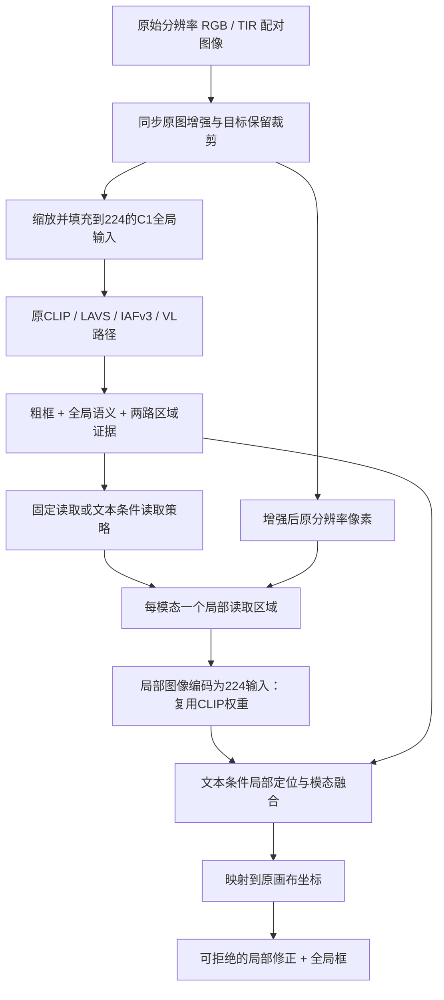

# 原图局部重观测：2026-10-27 实施与训练入口

## 当前交付

四组 seed13、各20轮已全部完成，三个局部方案均未通过匹配对照晋级条件。正式推荐模型仍为原C1。[完整结果](../output_clip_lavs_control/2026-10-27_native_reobserve/report.json)。61项相关检查通过；四组均完成真实双GPU预检，包括完整608条验证预测的C1初始化对齐，以及192条训练表达上的两次有效batch96更新。

最新状态：[status.json](../output_clip_lavs_control/2026-10-27_native_reobserve/status.json)。运行目录：`output_clip_lavs_control/2026-10-27_native_reobserve/`。

本轮为从正式C1出发的可行性筛选，没有新增测试集评估。固定局部读取的Acc@0.5为79.276%，但Acc@0.7和mIoU下降；文本自适应加一致性为78.947%／58.882%／66.463%，相对匹配C1续训仅多命中1条且mIoU略低。进一步干预分析与下一轮已启动方案见 [空间中心分布与相对定位收益](CLIP_SPATIAL_QUALITY_2026-10-27.md)。以下结构、配方和检查记录描述的是本轮已完成实验。

## 结构



原图在全局下采样之前保留；局部读取不是放大原224图或14×14特征。原图RGB/TIR同步几何增强，通过像素有效区、图像尺寸和缩放倍率完成坐标映射，模型不接收GT框。

固定初始读取范围为粗框3倍，最小范围相当于224画布上的64像素。自适应模式为每个模态预测有界的中心偏移与尺度变化。局部视图每路一个，均重新编码到224，复用已有两路LoRA对应的CLIP权重。

局部读取器使用完整文本token、全局语义和区域视觉信息。各模态局部预测映射到相同画布坐标后融合，并预测是否接受局部修正。输出修正零初始化，初始预测与C1一致；保留原外部LAVS，这不是完整替换实验。

## 四组实验

| 变体 | 读取策略 | 一致性监督 |
|---|---|---|
| `c1_continue` | 不读取局部图像 | 无 |
| `fixed_local` | 固定扩张区域 | 无 |
| `text_adaptive` | 文本条件的两模态独立偏移与尺度 | 无 |
| `text_consistent` | 同上 | 两个局部视图映射后的坐标一致性 |

三个局部方案均新增 **368,523** 个参数，使用相同的两张局部视图。新增一致性损失复用这两个局部视图，不增加CLIP编码次数。

四组共同微调C1最后一层VL、最终VL归一化层和框预测头，共 **3,680,772** 个基础参数，学习率1e-5。其他原模块冻结且保持eval行为。局部模块学习率1e-4，三个局部方案总可训练参数均为 **4,049,295**。

两张GPU，每卡batch4，梯度累积12步，名义有效batch96。训练20轮，使用2轮预热与余弦调度。关闭原对比、mask和token辅助损失，主损失保持2×L1+2×GIoU。

三个局部方案共同增加覆盖范围内的局部框损失与覆盖判断损失；只有D增加映射后的坐标一致性。未完整覆盖GT的局部视图不生成截断GT框，也不计算该视图的额外局部框损失；最终全局坐标预测仍接受正常GT监督。所有覆盖标签仅在损失函数中生成。

## 数据和比较边界

训练增强改为在原分辨率图像上进行目标保留裁剪和光度增强，再生成全局多尺度输入。它与旧C1的“先缩放再裁剪”训练流程不完全相同，四组使用同一新流程，因此A是必要的匹配对照。涉及方向词的表达保留原来的跳过裁剪规则。验证变换保持C1输入与标注坐标。

这轮使用冻结的C1 seed13、epoch100初始化，各组重新创建模型、优化器和调度器。预检中的更新不进入正式初始化。

一次已结束的临时实现冒烟检查误用了两个验证样本做梯度连通性检查；该模型没有保存权重，未用于训练、选模或精度报告。后续被接受的双GPU更新预检仅使用训练集192条表达，正式实验也从原C1独立重建。详见 [implementation_checks.json](../output_clip_lavs_control/2026-10-27_native_reobserve/implementation_checks.json)。

## 验证证据

- 61项检查覆盖原图采样与padding隔离、非正方形图像与平移坐标变换、读取位置梯度、文本条件策略、零输出初始化、未覆盖目标的损失、GT前向拒绝、参数范围、权重恢复和晋级规则。
- 四组完整验证集初始化的最大框坐标误差均为约2.68e-6，Acc@0.5/0.7命中数均为476/354，与C1一致。
- 每组每个rank均完成两次真实有效batch96优化更新；自适应策略、文本投影、局部输出和基础微调参数均有梯度并更新。
- 冻结权重摘要前后相同，模型delta、优化器、调度器和每个rank CUDA RNG恢复检查通过。
- 此次预检显存峰值约为：A每卡1.72GiB，三个局部方案每卡2.45GiB。完整训练峰值以日志为准。

[完整双卡预检](../output_clip_lavs_control/2026-10-27_native_reobserve/preflight.json)、[单元与回归检查日志](../output_clip_lavs_control/2026-10-27_native_reobserve/unit_tests.log)。

## 后台运行与选模

控制器使用独立tmux会话，在不可变源码快照内运行；每10秒更新状态。退出VSCode或断开SSH不会结束队列。启动器检查GPU占用、源码及资源SHA256、活跃进程，避免重复启动。

在有GPU设备访问权限的宿主环境中查看或恢复：

```bash
python -m script_train.clip_reobserve_control.control status
python -m script_train.clip_reobserve_control.control resume
```

最佳模型按首次严格达到验证Acc@0.5最大值选择，包含初始C1保底。同时独立保存实际训练后的最佳权重与末轮可恢复状态。恢复包括优化器、调度器、每rank RNG及选模写入日志。

自适应方案需同时超过原C1、匹配续训和固定局部读取，兼顾小目标、普通目标和弱光组，才值得继续多seed复验。固定局部读取的提升只证明局部分辨率收益。

四组仅筛选整个自适应读取设计。若要把增益进一步归因于“文本条件”，还需加入无文本自适应读取对照；若要独立证明“跨尺度一致性”，还需区分模态一致性和尺度一致性。当前不据此宣称创新已经成立。

本轮不会自动运行测试集或扩展其他seed。
